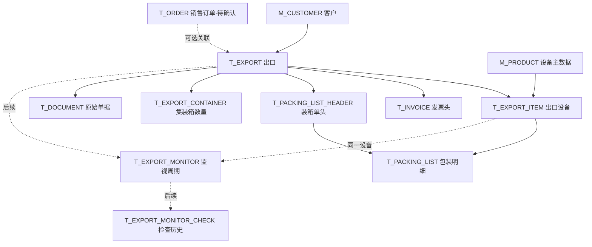

# 数据管理平台｜数据库结构审查与统一方案（v0.1）

> 状态：**技术结构已统一的设计草案，尚未通过日本公司业务确认，也未在真实 PostgreSQL 上执行建表测试。**  
> 依据：`M_CUSTOMER.xlsx`、`M_PRODUCT.xlsx`、`M_USER.xlsx`、`T_EXPORT.xlsx`、`T_INVOICE.xlsx`、`T_PACKING_LIST.xlsx`、`T_EXPORT_MONITOR.xlsx`、`販売輸出管理システム_必要テーブル一覧.xlsx`。  
> 原始资料：七份字段清单均附 Oracle DDL 样例；总文件还附十表清单、表间关系及设计备注。

## 1. 为什么需要统一

原表并非同一版本的一致数据库结构。部分文件把单据上的全部字段平铺到一个表，另一部分 DDL 仅创建少数明细字段；主外键类型、关联方向和表间关系也存在实际冲突。

这次采用 **“保留已有业务定义 → 分离记录层级 → 统一关联和数据类型 → 按功能分阶段实施”** 的方式，而非简单替换 Oracle 类型名称。

### 1.1 已核对的具体差异

| 序号 | 原始问题 | 处理结果 |
| --- | --- | --- |
| 1 | `T_EXPORT.EXPORT_ID` 是 `VARCHAR2(20 CHAR)`，`T_INVOICE.EXPORT_ID` 和 `T_PACKING_LIST.EXPORT_ID` 是 `NUMBER(12)` | 统一采用 `BIGINT` 内部键，相关 FK 同类型 |
| 2 | `T_EXPORT.INVOICE_ID` 和 `T_INVOICE.EXPORT_ID` 双向引用 | 保留 `T_INVOICE.EXPORT_ID`，不再在出口表重复保存发票 ID |
| 3 | `T_PACKING_LIST` 字段清单有 30 个字段，而其 DDL 只覆盖包装行的部分字段 | 单据头 `T_PACKING_LIST_HEADER` 和包装行 `T_PACKING_LIST` 分开 |
| 4 | 包装单中 `20' DRY × 1` 混写在 `CONTAINER_TYPE` 中，DDL 丢失箱型和数量 | 增加 `T_EXPORT_CONTAINER`，独立记录箱型、数量、数据来源性质 |
| 5 | 船名、ETD、ETA、合同号等在不同文件中的归属不一致 | 出口级共同运输字段集中 `T_EXPORT`；发票上印制的原始值仍在 `T_INVOICE` 作为单据快照 |
| 6 | `T_EXPORT_MONITOR` 使用 `EXPORT_NO`，总关系清单却定义按 `EXPORT_ID` 关联 | 统一监视记录引用 `EXPORT_ID` 与出口设备行 |
| 7 | 装箱行存在设备名和型号，但缺少与具体设备记录的稳定关联 | 增加 `T_EXPORT_ITEM`，每条包装行归属一条出口设备行 |
| 8 | 原始文件需要查看、下载、打印，但七个表无独立文件管理表 | 增加 `T_DOCUMENT` 存储原件关联及存储对象键 |
| 9 | 总清单提到销售主表、销售行、发票行，但并未提供独立字段设计文件 | 给出**待确认的候选设计**，不视为已经存在或最终确认 |
| 10 | “5年間監視”总清单提到每次检查结果，当前表只保存最近/下次日期 | 保留周期表 `T_EXPORT_MONITOR`，可选增加 `T_EXPORT_MONITOR_CHECK` |

## 2. 统一后的表结构（15 张候选表）

### 2.1 第一版建议核心表（10 张）

| 表名 | 内容 | 业务关系 |
| --- | --- | --- |
| `M_USER` | 登录用户、角色及登录安全状态 | 审计字段引用 `USER_ID` |
| `M_CUSTOMER` | 客户名称、地址、联系人 | 一个客户可以对应多次出口 |
| `M_PRODUCT` | 设备名称、制造商、型号、通用规格 | 通用资料，不直接代表每次包装尺寸 |
| `T_EXPORT` | 出口编号、客户、目的地、船名、ETD/ETA等 | 一次出口的主记录 |
| `T_EXPORT_ITEM` **（新）** | 此次出口有哪些设备、出运时名称与型号快照 | 一个出口对应多台/组设备 |
| `T_INVOICE` | Invoice 头、金额及单据上的其他原始信息 | 多份 Invoice 可归于同一出口（待确认） |
| `T_PACKING_LIST_HEADER` **（新）** | PL 单据编号/日期、唛头、单据记载的总数 | 一个出口可对应多份 PL |
| `T_PACKING_LIST` | 每条包装行、部件、尺寸、重量、体积 | 同时引用 PL 头与该批出口的具体设备 |
| `T_EXPORT_CONTAINER` **（新）** | 箱型、箱数、计划/单据记载/核实实际 | 为历史箱型和数量查询服务 |
| `T_DOCUMENT` **（新）** | PDF 等原始文件的名称、存储位置及所属业务 | 预览、下载、打印的统一入口 |

### 2.2 业务确认后再实施（5 张）

| 表名 | 来源 / 作用 | 当前状态 |
| --- | --- | --- |
| `T_ORDER` | 总清单存在，销售订单头 | 原始文件未给详细字段；候选 |
| `T_ORDER_DETAIL` | 总清单存在，销售订单行 | 原始文件未给详细字段；候选 |
| `T_INVOICE_DETAIL` | 总清单存在，发票多商品行 | 原始文件未给详细字段；候选 |
| `T_EXPORT_MONITOR` | 原始详细文件存在，出口监视周期及状态 | 关联字段重整；监视规则待确认 |
| `T_EXPORT_MONITOR_CHECK` **（新）** | 每次监视检查的日期、结果、人员及备注 | 原总清单有需求描述，新增候选表 |

**请注意：** 这里的“核心”表示目前功能需求值得保留，不等于要求一口气把十张表都开发完。可以先完成客户/设备/出口/装箱/集装箱的一个纵向功能闭环。

## 3. 主要关联关系

所有内部业务 ID 统一 `BIGINT`；用户 `USER_ID` 保留 `VARCHAR(50)`，所有审计字段 `CREATED_BY / UPDATED_BY` 均使用相同类型并可引用用户表。

**防止跨出口串联：** 装箱行同时指向 PL 头和出口设备行，使用 `(EXPORT_ID, PACKING_LIST_ID)`、`(EXPORT_ID, EXPORT_ITEM_ID)` 两组复合外键，确保包装行所指的设备与 PL 属于同一次出口。发票明细、监视记录和文件与发票/PL的关联也采用相同思想。

## 4. 每张核心表的信息归属

### 4.1 `M_CUSTOMER` / `M_PRODUCT` / `M_USER`

原则上保留原始基础信息。统一调整为 PostgreSQL 类型与审计规则；`M_PRODUCT` **新增 `MANUFACTURER` 制造商**，有利于按制造商+型号检索相似设备。

- 客户的历史交易记录不能依赖未来可变化的联系人、默认支付条件。
- `M_PRODUCT.UNIT_PRICE` 是**参考价**，不是每一次交易的实际成交金额。
- `M_USER.PASSWORD_HASH` 只存可靠算法生成的密码哈希，不存原始密码。

### 4.2 `T_EXPORT`：出口业务主表

除原有出口编号、客户、日期、目的地、出运方式、许可和状态外，增加/集中：

`CONTRACT_NO`、`SHIP_FROM`、`SHIP_TO`、`VESSEL`、`ETD_DATE`、`ETA_DATE`。

`INVOICE_ID` 不再存放于此；多个 Invoice 应由 `T_INVOICE.EXPORT_ID` 查询。可选 `ORDER_ID` 支持销售订单关联，但可以为空。

### 4.3 `T_EXPORT_ITEM`：一笔出口中的具体设备

设备主表只描述通用信息。一次实际出口里的设备名称、型号、序列号和数量由 `T_EXPORT_ITEM` 保存为业务快照。

它的出现是为了避免如下错误：同一出口运送 SPG-X 和 MC-500 两种设备，但只存了一组出口汇总包装信息，以后无法按设备查到相应包装记录。

### 4.4 `T_INVOICE`：商业发票

原始 27 个字段（发票号、日期、合同号、金额、货币、许可相关原始文本、检查信息、包装公司等）**均在新版中有对应去向**。

保留 `T_INVOICE.CONTRACT_NO / SHIP_FROM / SHIP_TO` 等看似与出口主表重复的字段，是因为它们反映**单据上实际印制的内容**，具有历史凭证意义，不应强制覆盖为当前 `T_EXPORT` 的最新值。

发票打印金额和若启用明细表后的行金额合计需要核对；不应静默覆盖原始票面金额。

### 4.5 `T_PACKING_LIST_HEADER` 与 `T_PACKING_LIST`

原 `T_PACKING_LIST` 有 30 个字段，实际上混合四种信息：

- **单据头：** PL 编号、签发日期、唛头、原件记载的包装总数/重量/体积 → `T_PACKING_LIST_HEADER`。
- **出口级运输信息：** 合同号、出发港、目的港、船名、ETD、ETA → `T_EXPORT`。
- **设备信息：** 设备名、型号 → `T_EXPORT_ITEM`。
- **包装明细：** 部件代码、部件名、件数、长宽高、重量和体积 → `T_PACKING_LIST`。

原文件中的 `PACKING_DATE` 在新版 PL 头命名为 `DOCUMENT_DATE`，以免和 Invoice 中的**实际包装作业日期**混淆。这两个日期在源表样例里并不相同，不可以合并。

汇总字段改为 `PACKAGE_COUNT_REPORTED`、`TOTAL_GROSS_WEIGHT_KG_REPORTED`、`TOTAL_VOLUME_M3_REPORTED`：这些是**原件记载值**。系统可以再对明细求和并做差异检查，但不能因为行求和结果与原件不一致就修改原始单据。

### 4.6 `T_EXPORT_CONTAINER`：集装箱配置

**这张新表直接对应你提出的核心需求。** 示例：

| EXPORT_NO | CONTAINER_TYPE | CONTAINER_QTY | RECORD_BASIS |
| --- | --- | ---: | --- |
| 示例出口记录 | `20DRY` | 1 | `DOCUMENTED` |

`RECORD_BASIS` 允许：

- `PLANNED`：尚在计划中的配置；
- `DOCUMENTED`：Packing List 或业务单据上记载的配置；
- `ACTUAL`：经实际出运记录确认的使用配置。

**现有样例只足以证明单据记载了 `20' DRY × 1`，不足以证明已经完成实际运输。** 因此示例应归类为 `DOCUMENTED`，不能直接当作 `ACTUAL` 训练推荐或统计实际历史箱数。

当前设计以“整笔出口 + 箱型 + 来源性质”保存数量。**它尚不能说明一台设备具体被装进哪一个物理箱号。** 如果日本公司明确需要设备/包装件与具体箱号的对应关系，应再引入包装件—箱实例分配结构，而非猜测分配关系。

### 4.7 `T_DOCUMENT`：原始文件

只保存文件元信息（文件类型、文件名、受控存储键、大小、所属出口或销售订单），文件实体可以在独立文件存储中。

附件可以进一步关联 `INVOICE_ID` 或 `PACKING_LIST_ID`，数据库复合外键确保该发票/PL与文件所属出口一致。打开、下载、打印前由 Java 后端重新校验权限。

## 5. 暂定开发顺序

1. **先建立技术基础：** PostgreSQL、Java Spring Boot、Vue 登录与左侧菜单。
2. **先验证关键数据链：** 出口 → 出口设备 → PL 头 → 包装行 → 箱型/数量 → 原始文件。
3. **再完善查询：** 按客户/Invoice号/型号筛选，详情中显示包装汇总与 Container 记录。
4. **最后扩展：** 销售多行订单、复杂发票多行、五年监视的逐次检查记录。

此顺序指**功能分阶段实现**，不是可以直接从全量 SQL 中任意删除表再执行：当前 `T_EXPORT.ORDER_ID` 和 `T_DOCUMENT.ORDER_ID` 仍有指向候选 `T_ORDER` 的外键，因此**这份完整 SQL 必须作为一套候选结构整体审查**。如果确认第一阶段不建销售表，必须另外编写“核心表建库 + 后续销售迁移”脚本，不能直接抽取部分 CREATE TABLE 执行。这项分阶段部署设计尚待业务确认。

## 6. 需要日本公司确认的业务问题

1. 历史 Container 数量是**计划、单据记载**还是**核实实际出运**？是否能获取实际凭证？
2. 是否需要定位到**每台设备分别用了哪个箱号**，还是只需整笔出口使用多少个箱？
3. 一条 PL 明细中的重量/体积是**每件值**还是**这一行的合计值**？数量大于1时如何计算？
4. 是否允许同一笔出口对应多份 Invoice、PL？如何处理更正版本？
5. 「販売管理」是否涉及正式录入销售订单，还是只读历史销售资料？
6. 「5年間監視」具体基于什么制度、如何计算监视期限、检查频率？
7. 老系统有多少实际历史数据？原 `EXPORT_ID` / `PRODUCT_ID` 等是否包含不可直接转数字的字符值？
8. 订单和发票原件是否需要保留签发时的**客户名称快照**与版本？

详细的优先级、保守默认做法和对设计的影响，请参见配套 Excel 的 **「待业务确认」** 工作表。

## 7. 一致性检查结果与限制

已用同一个结构定义生成：

- **15 张**完整候选表；
- **246 个**统一字段；
- **53 条**外键关系（包括各表审计用户引用）；
- **149 个**原始详细字段的去向映射；
- PostgreSQL DDL + 字段字典 + 主外键关系统一输出。

已进行的静态检查：表名存在性、字段唯一性、外键目标存在、外键列类型一致、复合外键引用唯一约束、原字段去向覆盖。**未连接生产 PostgreSQL 执行真实建表与历史数据迁移**，因此不能把这些检查视为生产部署验证。源文件中的所有业务样例还需要用原始合同/单据逐项确认。

## 8. 为什么要这样修改（最终解释）

**第一，保证跨表数据能够真实关联。** 原先不同类型的 `EXPORT_ID` 和双向发票引用，会让建表、写入和查询都容易出错；同一类型的 ID、单向外键和复合一致性约束能从数据库层面防止部分错误关联。

**第二，让数据结构符合业务对象。** 一次出口、一台设备、一份装箱单、一条包装件和一个集装箱配置不是同一个对象。分开保存后，历史查询不会因“多个设备共用一个出口”而把规格混在一起。

**第三，不重复维护可能变化的业务信息。** 出口共用的船名、ETA 等放在出口主表，监视页通过外键查询；这样修改一次不需要同步多个表。与此不同，Invoice、Packing List 上的票面数据需要作为**不可随意改动的历史快照**保留。

**第四，真正满足“根据历史记录参考 Container 数量”的核心需求。** 集装箱箱型和数量必须是可查询的独立数据，且必须区分计划、单据记载与实际核验，否则查询结果容易被误用，反而增加物流风险和成本。

**第五，兼顾第一版开发与未来增长。** 当前必需部分聚焦于出口、包装、集装箱和原票；销售明细、监视检查历史虽然已补齐候选关系，但没有在业务确认前把它们硬塞进第一版。

**第六，为旧数据和 PostgreSQL 迁移保留可追溯性。** 149 个原始字段都有去向记录；旧编号不能简单直接转成新整数主键，必须在拿到实际历史数据后进行映射和校验。这样才能保证后续开发有依据，避免整理过程中丢失信息。

---

**随附文件：** `数据库统一设计_v0.1.xlsx`（含全部字段、外键、原字段去向及修改理由）、`schema_postgresql_v0.1.sql`（完整候选 PostgreSQL 建表脚本）、`validation.json`（静态检查摘要）。
