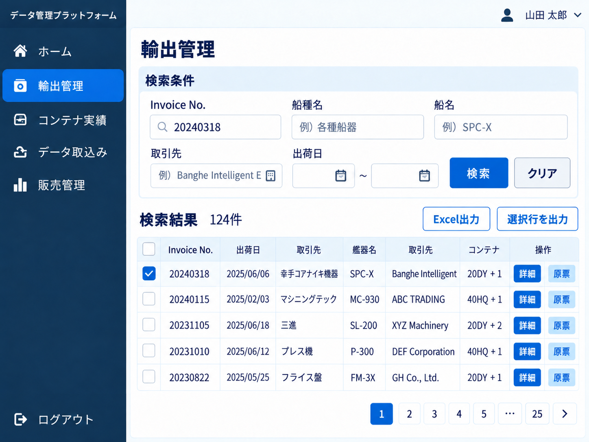
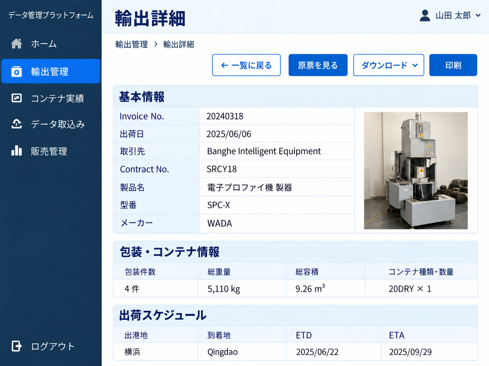
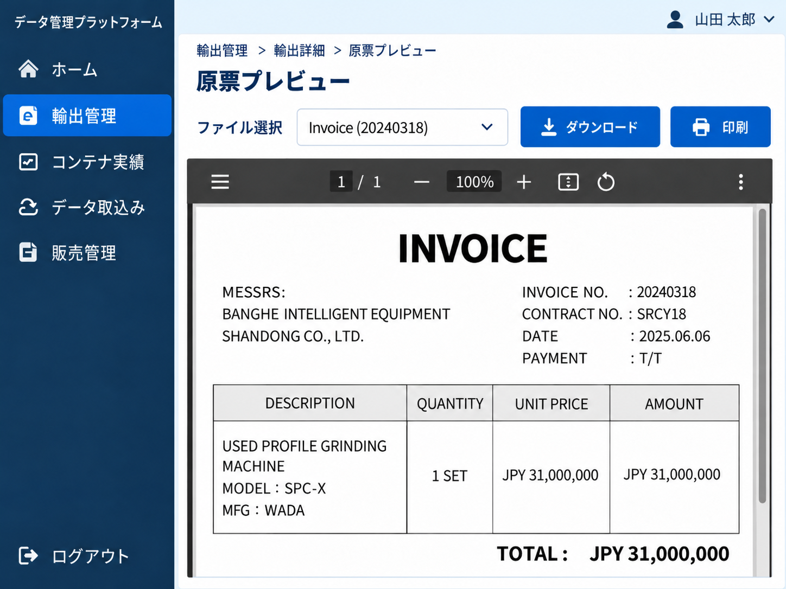
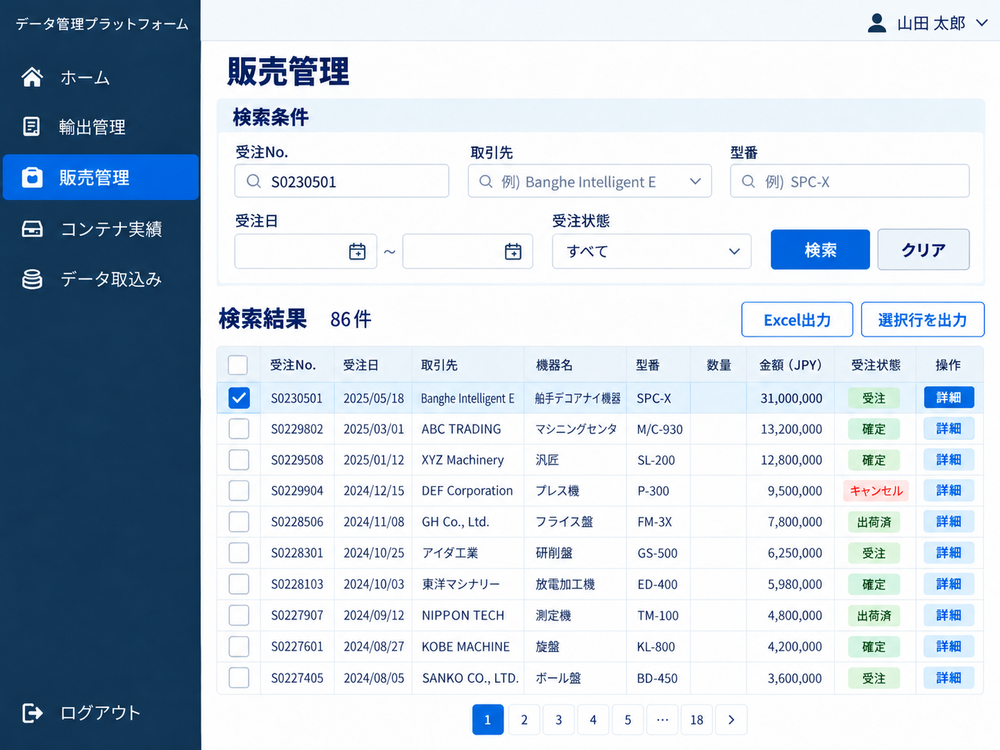
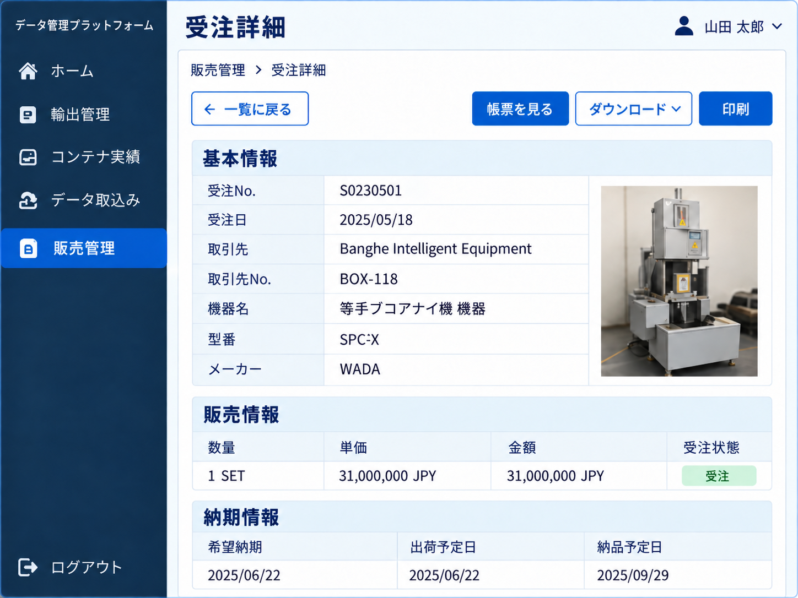
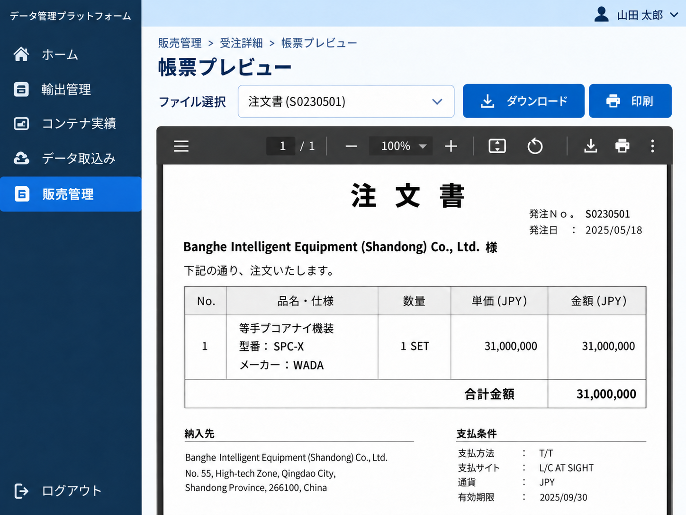
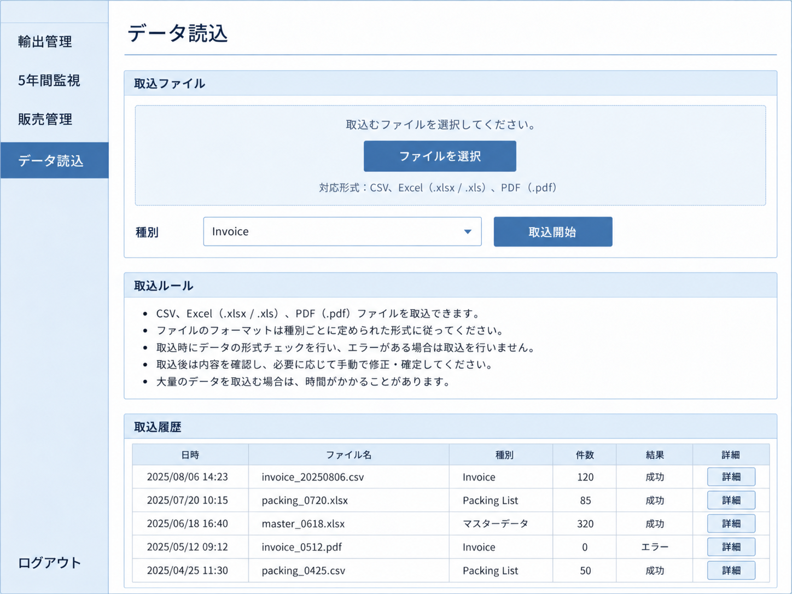
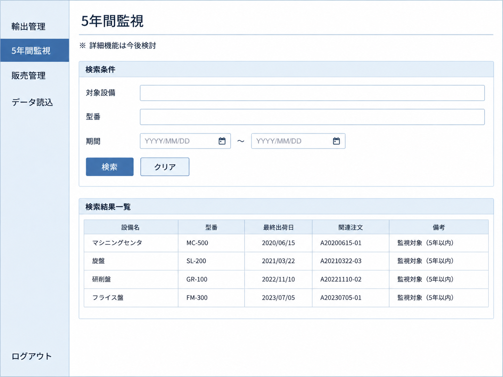
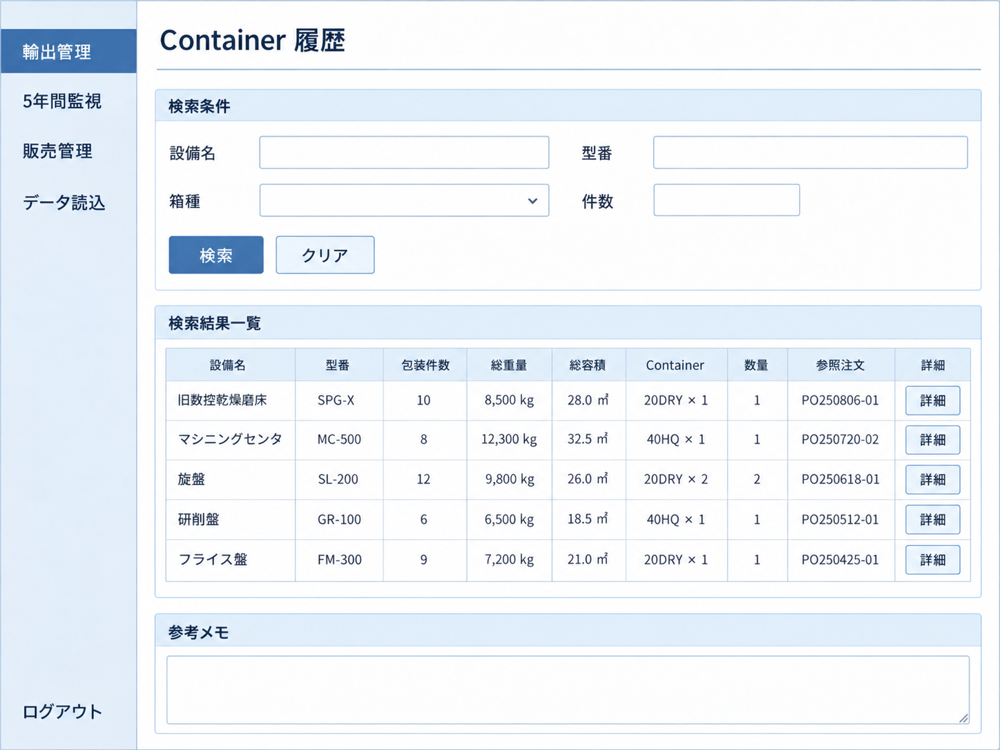
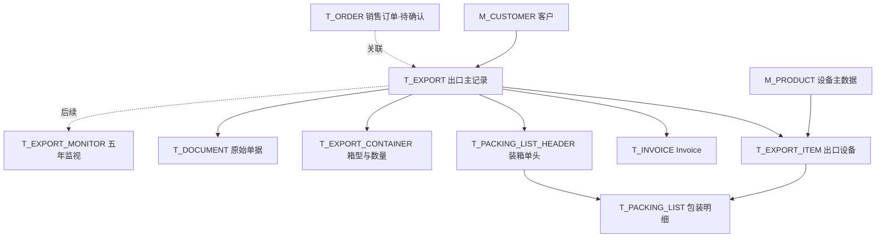

# 数据管理平台系统设计

> **版本：** v0.7（技术架构 + 功能界面 + 数据库设计）  
> **状态：** 初步设计 / 持续迭代  
> **开发模式：** 少人开发，持续迭代  
> **当前阶段：** 需求梳理、界面流程与数据库结构草案确认

---

## 1. 项目定位与目标

本系统面向日本公司的贸易与出口业务，建设一个**简洁、可查询、便于持续扩展的 Web 数据管理系统**。

系统第一版的重点不是复杂分析，而是：

- 集中保存并查询历史订单数据；
- 查看设备规格、包装尺寸、重量和集装箱使用记录；
- 结合历史出货信息，为新订单提供运输安排参考；
- 支持查看原始单据（Invoice、Packing List、销售相关帐票）并进行下载或打印。

其核心目标是减少重复查找、减少重复核算，并降低因集装箱安排不合理而带来的额外成本。

---

## 2. 核心技术组合

| 层级 | 核心技术 | 主要职责 |
| --- | --- | --- |
| 前端 | Vue 3 + TypeScript | 登录、导航菜单、查询列表、详情页面 |
| 后端 | Java + Spring Boot | 查询接口、业务逻辑、权限校验 |
| 数据库 | PostgreSQL | 订单、设备包装和集装箱记录 |
| 部署 | Linux + Docker Compose + Nginx | Web 访问及应用部署 |

说明：第一版暂不引入微服务、自动装箱算法或复杂智能推荐功能。

---

## 3. 系统总体架构

```text
用户浏览器
    │
    ▼
Vue 页面（登录 / 查询 / 详情 / 单据预览）
    │ HTTPS / API
    ▼
Java + Spring Boot（业务处理 / 权限校验）
    │
    ▼
PostgreSQL（历史业务数据）

原始 Invoice / Packing List / 帐票文件作为附件保存。
```

后端统一负责数据查询、业务逻辑和访问控制，前端不直接访问数据库。

---

## 4. 第一版设计原则

- **界面简洁：** 采用传统企业系统风格，登录页 + 左侧菜单 + 右侧内容区。
- **查询优先：** 优先保证历史订单、包装规格、集装箱记录可搜索、可查看、可核对。
- **流程清晰：** 列表页仅展示关键信息；完整信息在详情页查看；原始文件在预览页查看。
- **可输出：** 在适当页面支持下载、打印或导出。
- **逐步扩展：** 第一版先完成基础业务闭环，后续再扩展更复杂能力。

---

## 5. 菜单与模块定位

| 菜单名称 | 中文理解 | 当前定位 |
| --- | --- | --- |
| 輸出管理 | 出口管理 | 核心模块。查询历史出货记录、设备规格、包装信息与集装箱配置。 |
| 5年間監視 | 五年监视 / 跟踪 | 保留入口，具体业务规则待确认。 |
| 販売管理 | 销售管理 | 查询销售订单、客户、金额、状态及相关帐票。 |
| データ読込 | 数据导入 | 导入历史资料，如 Invoice、Packing List、Excel 数据等。 |
| ログアウト | 退出登录 | 结束当前会话。 |

### 5.1 輸出管理 与 販売管理 的区别

- **輸出管理**：重点关注“如何出货”，包括设备、包装、重量、体积、集装箱、船期及原始出货单据。
- **販売管理**：重点关注“卖给谁、卖了什么”，包括客户、订单、金额、状态及销售相关帐票。

可简化理解为：

- **販売管理负责“销售”**
- **輸出管理负责“出口与运输”**

---

## 6. 业务信息范围（初步）

系统需要围绕以下几类信息进行管理：

| 信息类别 | 主要内容 |
| --- | --- |
| 订单信息 | Invoice 编号、订单日期、客户、设备名称、型号 |
| 包装信息 | 分解部品、件数、长宽高、重量、体积 |
| 集装箱信息 | 箱型、数量、ETD、ETA、船名等 |
| 销售信息 | 订单编号、金额、状态、客户、担当 |
| 原始文件 | Invoice、Packing List、合同、销售帐票等 |

说明：本章为业务字段范围概述，详细的数据对象和关联关系见第 15～18 章。已形成数据库统一设计 v0.1 技术草案，仍待日本公司确认业务规则。

---

## 7. 页面设计思路

为了避免在一个列表中堆叠过多字段，第一版建议统一采用以下三层结构：

1. **搜索列表页**：用于输入条件并查看检索结果；
2. **详情页**：用于查看完整业务信息；
3. **单据预览页**：用于查看原始文件，并执行下载或打印。

这样的设计比“把所有字段都放进列表表格”更清晰，也更适合后续增加字段。

---

## 8. 界面模板（拆分后展示）

以下图片均已拆分展示，便于在 Markdown 中直接查看。图片主要用于确认**页面结构、逻辑关系和操作流程**；其中示例数据仅为占位内容。

### 8.1 登录页面


---

## 9. 輸出管理流程设计

### 9.1 流程说明

**輸出管理**推荐采用以下流程：

**輸出管理（搜索列表） → 輸出詳細 → 原票プレビュー**

列表页中每一条记录建议至少提供以下操作：

- **詳細**：进入「輸出詳細」页面；
- **原票**：直接查看原始单据；
- **ダウンロード**：直接下载该记录关联文件（后续可按实际需要保留或移至预览页）。

### 9.2 輸出管理：搜索列表页

功能重点：

- 根据 Invoice No.、设备名、型号、客户、日期进行检索；
- 在结果列表中显示关键字段；
- 列表页支持导出（如 CSV）和打印结果列表。



### 9.3 輸出詳細：详情页

功能重点：

- 显示当前记录的基本信息；
- 显示包装明细与集装箱信息；
- 通过按钮跳转到原票预览；
- 支持返回列表、下载 PDF 或打印。



### 9.4 原票プレビュー：原始单据预览页

功能重点：

- 显示 Invoice、Packing List 等原始文件；
- 支持下载与打印；
- 支持返回详情页或列表页。



---

## 10. 販売管理流程设计

### 10.1 流程说明

**販売管理**推荐采用以下流程：

**販売管理（搜索列表） → 受注詳細 → 帳票プレビュー**

这里需要注意命名：

- 在**輸出管理**中，详情页建议命名为 **輸出詳細**；
- 在**販売管理**中，详情页建议命名为 **受注詳細**；
- 避免统一使用含义模糊的「注文詳細」，以减少业务混淆。

### 10.2 販売管理：搜索列表页

功能重点：

- 根据受注 No.、客户、设备名、状态、日期进行检索；
- 查看销售记录、金额与状态；
- 支持列表导出与打印。



### 10.3 受注詳細：详情页

功能重点：

- 显示订单基本信息、客户、金额、状态、担当等；
- 显示关联合同或 Invoice 编号；
- 支持查看销售相关帐票。



### 10.4 帳票プレビュー：销售单据预览页

功能重点：

- 预览见积书、合同、订单书等销售相关文件；
- 支持下载和打印；
- 支持返回详情页或列表页。



---

## 11. 其他辅助页面

### 11.1 データ読込（数据导入）

功能重点：

- 上传 Excel、CSV、PDF 等文件；
- 选择导入类型；
- 显示导入历史和导入结果。



### 11.2 5年間監視（预留模块）

当前仅作为结构预留页面，具体业务规则待与企业进一步确认。



### 11.3 Container 履歴（补充参考页面）

该页面可作为补充查询入口，用于单独查看设备与集装箱配置的历史记录。



---

## 12. 第一版功能范围

### 12.1 优先实现

- 登录 / 退出；
- 輸出管理：历史记录检索、详情查看、原票预览；
- 販売管理：销售记录检索、详情查看、帐票预览（**界面范围已规划，销售数据表与业务规则尚待确认**）；
- 数据导入；
- 原始文件的下载与打印。

### 12.2 暂不实施

- 自动装箱算法；
- AI 推荐；
- 复杂图表与仪表盘；
- 独立移动 App。

---

## 13. 待确认事项

- 日本公司旧系统中各菜单的真实业务含义；
- 历史数据来源（Excel、PDF、扫描件、旧数据库等）；
- 列表页与详情页的最终字段；
- 下载按钮是否保留在列表页，或统一放在预览页；
- 用户权限划分；
- 统一数据库设计 v0.1 中仍未确认的业务规则、历史数据关联与旧系统 ID 映射。

---

## 14. 当前建议

从第一版的实用性来看，我更建议：

- **列表页尽量简洁**，只展示关键字段；
- **完整信息放入详情页**；
- **文件下载与打印集中在预览页**，必要时列表页保留快捷下载；
- **先把輸出管理流程做完整**，再扩展販売管理与其他模块。

这样既能保证系统清晰，也更利于后续开发和数据库设计。

---

**下一步建议：** 基于第 15～18 章的统一数据库草案，优先确认实际集装箱记录、包装行数量与重量含义、销售业务范围，再实施 PostgreSQL 第一阶段迁移。

---

## 15. 数据库设计总览（统一版 v0.1）

> **设计状态：技术草案，非生产实施基线。** 本章将此前独立的《数据库统一设计 v0.1》纳入平台设计。数据库依据日本公司的 7 份字段设计表和 1 份总表清单整理；原 Oracle DDL 与字段清单之间存在差异，已在统一方案中记录。完整字段字典、原字段去向、建表 SQL 与检查说明见 [`database/`](database/)。

### 15.1 数据库设计目标

- **按业务对象分层：** 客户、设备、出口、出口设备、发票、装箱单、集装箱与文件各自独立。
- **确保数据可以关联：** 主外键和字段类型统一，不靠复制同一笔记录到多个业务表来实现搜索。
- **保留历史依据：** 设备的通用主数据与某次实际出货的名称、型号、包装规格分别保存。
- **支持核心查询：** 能从设备型号或历史出口记录，追查包装明细、箱型及箱数，并打开对应原始单据。
- **允许分阶段实现：** 第一版优先实现出口查询链，销售与出口监视等功能在业务确认后展开。

### 15.2 数据表清单

当前统一方案共有 **15 张候选表**，其中 **10 张列为第一版建议核心表、5 张为后续/待业务确认表**。“核心”不表示必须第一天一次性开发完毕。

| 表名 | 中文用途 | 阶段 | 关键关联或信息 |
| --- | --- | --- | --- |
| `M_USER` | 登录用户 | 核心 | `USER_ID`、权限角色、密码哈希 |
| `M_CUSTOMER` | 客户主数据 | 核心 | `CUSTOMER_ID`、客户代码、名称 |
| `M_PRODUCT` | 设备/商品主数据 | 核心 | `PRODUCT_ID`、型号、制造商 |
| `T_EXPORT` | 出口业务主记录 | 核心 | `EXPORT_ID`、`EXPORT_NO`、`CUSTOMER_ID`、船期 |
| `T_EXPORT_ITEM` | 每笔出口的设备明细 | 核心（新增） | `EXPORT_ID`、`PRODUCT_ID`、出货时设备快照 |
| `T_INVOICE` | 商业发票 | 核心 | `EXPORT_ID`、`INVOICE_NO`、票面金额 |
| `T_PACKING_LIST_HEADER` | Packing List 单据头 | 核心（新增） | `EXPORT_ID`、单据日期、原件汇总值 |
| `T_PACKING_LIST` | 包装明细 | 核心 | `PACKING_LIST_ID`、`EXPORT_ITEM_ID`、尺寸/重量/体积 |
| `T_EXPORT_CONTAINER` | 集装箱配置记录 | 核心（新增） | `EXPORT_ID`、箱型、箱数、记录依据 |
| `T_DOCUMENT` | 原始文件元信息 | 核心（新增） | 文件类型、存储键、所属业务 |
| `T_ORDER` | 销售订单主记录 | 待确认 | 销售订单编号、客户、状态 |
| `T_ORDER_DETAIL` | 销售订单行 | 待确认 | 订单关联商品、数量、价格 |
| `T_INVOICE_DETAIL` | 发票商品明细 | 待确认 | 发票关联设备及明细金额 |
| `T_EXPORT_MONITOR` | 出口后监视周期 | 待确认 | 出口设备、开始/结束日期、当前状态 |
| `T_EXPORT_MONITOR_CHECK` | 每次监视检查 | 待确认（新增） | 检查日期、结果、检查人 |

**资料边界：** `T_ORDER`、`T_ORDER_DETAIL`、`T_INVOICE_DETAIL` 在原总清单中出现，但没有提供对应的详细字段设计文件。新增表与未证实的字段均属于统一方案建议，不能视为日本公司已确认的业务事实。

### 15.3 主要表间关系



业务理解：**一个客户可对应多次出口；一次出口可包含多个设备、多个包装件、若干 Invoice/PL 以及一个或多个集装箱配置记录。** 每条包装明细归属于同一次出口下的一条设备记录，避免设备和包装混淆。多份单据与更正版本的精确规则仍待确认。

### 15.4 核心信息存储位置

| 需要查询的内容 | 推荐主存储位置 | 设计原则 |
| --- | --- | --- |
| 通用设备型号、制造商 | `M_PRODUCT` | 作为设备主资料，可随主数据维护 |
| 某次出口的设备名称、型号、数量 | `T_EXPORT_ITEM` | 记录出货当时的快照 |
| Invoice No.、日期、金额 | `T_INVOICE` | 保留单据记载值，关联出口 |
| PL 编号、日期和原件合计 | `T_PACKING_LIST_HEADER` | 区分原件汇总值与系统计算值 |
| 包装件长宽高、重量、体积 | `T_PACKING_LIST` | 每条记录关联该批出口的具体设备 |
| 箱型、数量、依据类别 | `T_EXPORT_CONTAINER` | 不能把计划或文件记载当作实际出货 |
| PDF/Excel 原始文件 | `T_DOCUMENT` | 保存文件元数据，文件实体在受控存储中 |
| 船名、ETD、ETA、目的地 | `T_EXPORT` | 出口业务通用字段集中维护 |

---

## 16. 集装箱与装箱数据的重点设计

### 16.1 为什么必须独立记录 Container

**本项目的业务重点是根据历史规格参考集装箱数量。** 因此不能把 `20' DRY × 1` 仅作为一段字符串写在 Packing List 备注中；需要能够独立查询的箱型、箱数和依据类别。

统一方案新增 `T_EXPORT_CONTAINER`，关键字段如下：

| 字段 | 含义 | 示例 |
| --- | --- | --- |
| `EXPORT_ID` | 对应哪一次出口 | 对应内部出口主键 |
| `CONTAINER_TYPE` | 集装箱类型 | `20DRY` |
| `CONTAINER_QTY` | 集装箱数量 | `1` |
| `RECORD_BASIS` | 信息依据 | `PLANNED` / `DOCUMENTED` / `ACTUAL` |
| `SOURCE_TEXT` | 来源说明 | 对应 PL 或出运凭证 |

三种依据含义：

- `PLANNED`：尚未执行的计划配置；
- `DOCUMENTED`：Invoice、Packing List 等单据上**记载**的配置；
- `ACTUAL`：有实际出运凭证支持的**已核实**配置。

例如样例单据出现 `20' DRY × 1`，现阶段最多可以登记为 `DOCUMENTED`；只有取得实际出货依据，才能登记为 `ACTUAL`。推荐展示时应标明依据类别。

**当前结构只统计整笔出口的箱型及数量**，尚不能准确表达“一台设备的哪些包装件装入某一个具体物理箱号”。如果客户需要箱号级分配追踪，后续再设计包装件与箱实例的对应表。

### 16.2 包装明细与原件保持一致

`T_PACKING_LIST` 保存包装行的数量、长度、宽度、高度、毛重和体积；`T_PACKING_LIST_HEADER` 保存 PL 原件记载的包装件总数、总重量和总体积。

如果明细汇总值与单据记载值不同，系统应**提示差异并人工核对**，而不是自动覆盖原始单据。还需确认原 Excel 的重量、体积究竟是单件值还是整行合计值，尤其当件数大于 1 时。

---

## 17. 统一规范、原设计问题与修改原因

### 17.1 字段与关联规范

- 业务内部主键和对应外键统一使用 PostgreSQL `BIGINT`；业务可读编号（如 `EXPORT_NO`、`INVOICE_NO`）另行保存，不能把旧业务编号强行转换为新主键。
- `M_USER.USER_ID` 继续使用 `VARCHAR(50)`；审计字段 `CREATED_BY`、`UPDATED_BY` 保持同类型。
- 需要精确记录的金额、重量、体积采用 `NUMERIC`；日期与时间根据含义采用 `DATE` 或 `TIMESTAMPTZ`。
- 统一由 `T_INVOICE.EXPORT_ID` 指向出口主表，取消出口与发票之间互相保存对方主键的循环关系。
- 通过包含 `EXPORT_ID` 的复合外键，防止把 A 出口的装箱行误关联到 B 出口的设备或单据。
- 对原始文件只保存受控存储键与元数据，下载/预览/打印均由 Java 后端执行权限校验。

### 17.2 原 Excel 设计问题与本次处理

| 原来的不一致或缺失 | 统一方案 | 原因 |
| --- | --- | --- |
| `EXPORT_ID` 在不同表中类型不同 | 全部统一为 `BIGINT` | 保证外键可建立且迁移规则明确 |
| 发票和出口互相引用 | 发票指向出口 | 避免循环依赖与重复维护 |
| Packing List 字段清单与原 DDL 不一致 | 分为单据头和包装行 | 不混合单据汇总和每件包装数据 |
| 设备型号和包装行没有稳定对应关系 | 增加 `T_EXPORT_ITEM` | 支持一笔出口包含多种设备 |
| 只有箱型文字，缺少独立箱数 | 增加 `T_EXPORT_CONTAINER` | 为历史箱数检索提供结构化数据 |
| 船期、港口信息散落在多处 | 出口级字段集中 `T_EXPORT` | 减少重复维护；单据自身快照仍保留 |
| 监视表无法记录每次检查历史 | 可选增加 `T_EXPORT_MONITOR_CHECK` | 区分当前状态与检查过程 |
| 原票没有单独的文件关联信息 | 增加 `T_DOCUMENT` | 为详情页中的预览/下载/打印服务 |

**设计取舍：** 对于 `INVOICE` 上实际印制的合同号、装运地点等，即使与出口级信息存在重复，也应保留原件快照；不能为了消除重复而丢失历史单据的原始内容。

---

## 18. 第一版落地范围与数据库待确认事项

### 18.1 功能实施建议

1. **基础阶段：** 建立 PostgreSQL 环境、用户登录及基础客户/设备数据。
2. **出口闭环：** 完成 `T_EXPORT` → `T_EXPORT_ITEM` → `T_PACKING_LIST_HEADER` → `T_PACKING_LIST` → `T_EXPORT_CONTAINER` → `T_DOCUMENT` 的查询路径，连接 Invoice 原始文件。
3. **查询完善：** 以设备型号、Invoice 编号、客户及日期为条件查询，展示包装汇总和箱型数量。
4. **后续模块：** 在确认销售订单和五年监视业务之后，再实施相应候选表。

**实施限制：** 随附的 `schema_postgresql_v0.1.sql` 是包含全部 15 张表的候选 DDL，其中核心表仍有对候选 `T_ORDER` 的外键。**不能直接删除后续表的建表语句，把剩余 SQL 当成可独立部署的第一阶段脚本。** 正式实施时需另外整理按阶段执行的数据库迁移脚本。

### 18.2 需要向日本公司确认

| 问题 | 为什么重要 |
| --- | --- |
| 集装箱记录是计划、文件记载还是实际出运？ | 决定历史箱数能否作为可靠的实际参考 |
| 是否需要设备/包装件关联到具体箱号？ | 决定需不需要新增箱实例及分配明细结构 |
| 包装明细重量与体积是单件还是整行合计？ | 影响汇总计算和同类设备比较 |
| 一次出口是否可能关联多张发票和多张 PL？ | 影响单据唯一规则与版本管理 |
| 販売管理是只查询还是录入销售订单？ | 决定 `T_ORDER`、`T_ORDER_DETAIL` 的实施范围 |
| 5年間監視 的依据、周期和检查业务是什么？ | 决定监视表何时启用及实际字段 |
| 旧系统 ID、历史数据量与导入格式是什么？ | 决定数据清洗、主键映射和迁移工作量 |

### 18.3 当前验证范围与附件

统一数据库 v0.1 的静态输出包括 **15 张表、246 个字段、53 条外键、149 个原字段映射**。已对引用关系及字段类型等进行静态检查；**尚未在 PostgreSQL 实例中执行建表、导入真实历史数据或进行生产运行验证**。

配套附件：

- [数据库结构审查与统一方案（详细版）](database/数据库结构审查与统一方案.md)
- [完整字段字典与原字段映射（Excel）](database/数据库统一设计_v0.1.xlsx)
- [PostgreSQL 候选建表 SQL](database/schema_postgresql_v0.1.sql)
- [静态校验结果](database/validation.json)

> **版本记录：** v0.7 基于用户提供的 v0.6 文档添加统一数据库设计章节，保留原有界面结构、页面流程与图片引用。数据库章节对齐独立数据库设计 v0.1；业务确认和可运行迁移脚本留待下一阶段。
